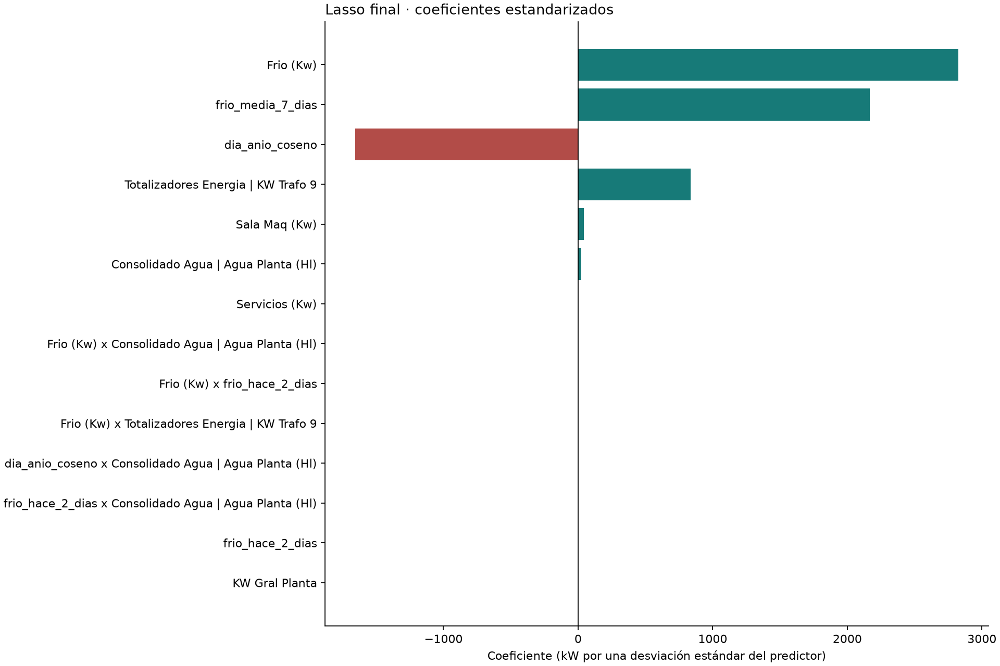
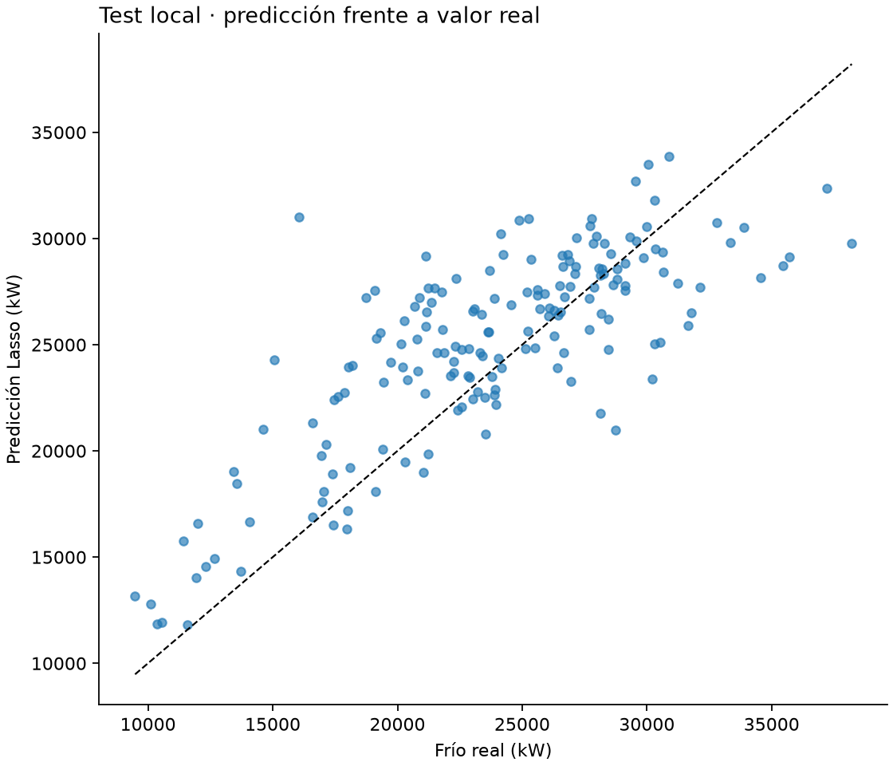
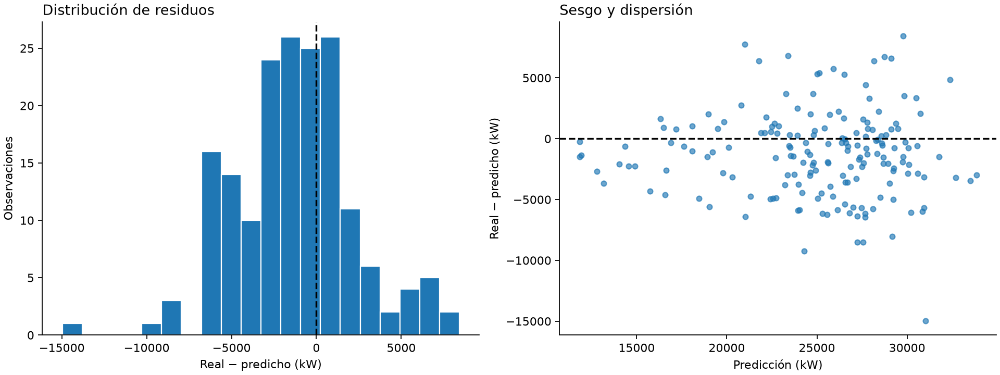
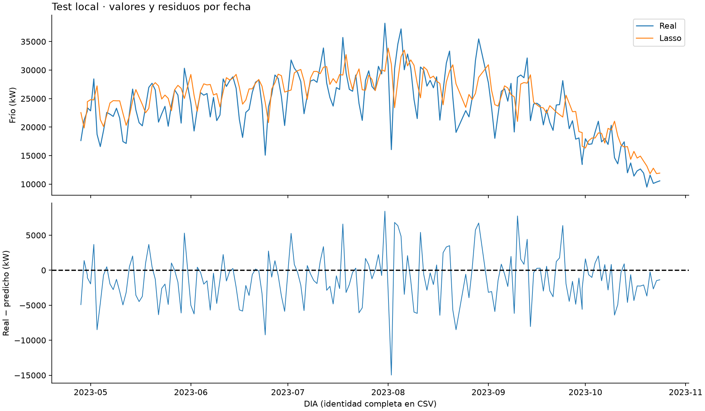

# Cierre de Fase 3 — Lasso v1.0.0

## Selección y entrenamiento

Se mantuvo Lasso con las 14 entradas históricas y pipeline A. MAE de validación original: 2215.796375483132; RMSE: 2835.803833786694; R²: 0.4676090070547668. Es evidencia de selección, no una nueva medición del modelo reentrenado. El ranking histórico permanece en [comparacion_modelos_final.md](../comparacion_modelos_final.md).

Se reajustaron conjuntamente mediana, StandardScaler y Lasso con 1006 filas etiquetadas (830 train y 176 validation). Se conservaron las etiquetas de frontera eliminadas por Fase 2; no se reconstruyó ninguna. Parámetros: `{'alpha': 75.0, 'max_iter': 20000, 'random_state': 42}`. Commit del código entrenado: `6afd3c0bcb02bc98c0348e19cbe690d5c747f97b`. Python 3.12.14; semilla 42. Dos ajustes independientes con esos datos dieron iguales coeficientes y predicciones antes de test. La carga joblib reprodujo exactamente las predicciones de ajuste.

Artefacto: `models/modelo_v1.0.0.pkl`; SHA-256 `bd369dd8114230477671af1efe5d05b3c2dc01dd1b6ec4383e89829f54bc616d`. El artefacto incluye orden de variables, imputador, escalador y estimador. [entrenamiento.json](entrenamiento.json) conserva parámetros, índices y huellas. [coeficientes.csv](coeficientes.csv) enumera las 14 entradas, sus coeficientes y escalas. El registry separa validación original y test local.

## Evaluación local única

No se encontró evaluación final previa en los registros y ramas inspeccionados. Se creó test_consumido.json antes de cargar las observaciones de prueba. Solo hubo una llamada de predicción sobre test del artefacto congelado. Las consultas y el notebook leen evidencia archivada.

Test contiene 178 filas etiquetadas; se evaluaron exactamente **176** con objetivo y ambos baselines disponibles. Se excluyeron los índices [1070, 1123]. Modelo, persistencia y media móvil comparten las mismas filas, target y fechas. No se asumió el tamaño de validación. La ventana del baseline es de siete bloques, incluido D, con mínimo cuatro valores válidos, según la política existente.

| Modelo | MAE test | RMSE test | R² test |
|---|---:|---:|---:|
| lasso | 2886.038955973457 | 3737.100018045103 | 0.574968859941 |
| persistencia | 3291.982954545455 | 4263.763539063283 | 0.446729479858 |
| media_movil | 3063.784496753246 | 3979.543389260692 | 0.518032453462 |

Frente a persistencia: reducción absoluta de MAE 405.943998571998 kW y mejora 12.331291024 %. Frente a media móvil: 177.745540779790 kW y 5.801502716 %. Los signos negativos indican empeoramiento. ¿Supera ambos baselines?: **True**. ¿MAE local menor a 3000?: **True**. El umbral eliminatorio corresponde al test oculto de la cátedra; este resultado local no lo acredita.

La mejora es menor al 10 %. No justificaría desplegar este pipeline por precisión únicamente: se compra una relación lineal interpretable y reutilización de la preparación, pero se mantienen imputación, escalado y dependencias. El baseline sigue siendo una referencia operativa de bajo costo. Se conserva Lasso por la selección ya fijada; no se lo reemplaza ni ajusta después de observar test.

## Interpretación de coeficientes

Magnitudes mayores del modelo reajustado:

- `Frio (Kw)`: +2824.711287882 kW por desviación estándar.
- `frio_media_7_dias`: +2166.681866467 kW por desviación estándar.
- `dia_anio_coseno`: -1655.266216879 kW por desviación estándar.
- `Totalizadores Energia | KW Trafo 9`: +834.595962065 kW por desviación estándar.
- `Sala Maq (Kw)`: +44.321820085 kW por desviación estándar.

Hay 6 coeficientes no nulos de 14. Cada coeficiente expresa el cambio de predicción por una desviación estándar del predictor después de imputar, manteniendo los otros fijos. El signo positivo aumenta y el negativo disminuye la predicción. Productos y variables originales comparten información; correlación y regularización redistribuyen sus coeficientes. Magnitud no equivale a contribución total, efecto causal ni importancia estable fuera de muestra.

## Residuos y errores grandes

Residuo = real − predicho. Media: -1274.472770592 kW; mediana: -1334.093687976; desvío muestral: 3523.089458767; percentil 90 de error absoluto: 6133.789649626. Hubo 58 subestimaciones y 118 sobreestimaciones. El signo de la media muestra la dirección del sesgo agregado, sin probar significación estadística. [residuos_por_cuartil.csv](residuos_por_cuartil.csv) permite contrastar ese sesgo por nivel real de consumo.

| Índice CSV | DIA | Real | Predicho | Residuo |
|---:|---|---:|---:|---:|
| 1102 | 2023-08-02 | 16048.000 | 31018.715 | -14970.715 |
| 1063 | 2023-06-24 | 15073.000 | 24301.864 | -9228.864 |
| 1012 | 2023-05-03 | 18731.000 | 27229.614 | -8498.614 |
| 1122 | 2023-08-22 | 19075.000 | 27568.667 | -8493.667 |
| 1100 | 2023-07-31 | 38215.000 | 29784.189 | +8430.811 |

Los errores extremos y la dispersión se reportan como diagnóstico posterior; no se eliminan observaciones ni se cambian parámetros a partir de ellos. [predicciones_test.csv](predicciones_test.csv) conserva valores, baselines, residuos e identidad física para auditar sin una nueva predicción.

## Limitaciones y conclusión técnica

La selección reutilizó validation, que ya había intervenido en la elección de variables; su MAE puede ser optimista. El contrato operativo vigente tiene quince entradas, pero este modelo usa explícitamente las catorce ganadoras: es_fin_de_anio no entra. La etiqueta utiliza consumo del bloque siguiente. DIA no siempre es único y no está demostrada la correspondencia entre bloque y fecha física ni la disponibilidad real de todas las entradas al cierre D. Se comprobó separación por índices y orden temporal y ausencia de test en los ajustes; esto no certifica ausencia absoluta de fuga operativa. Los baselines usan la historia disponible hasta el bloque D y no el valor objetivo futuro.

El resultado de test no se utilizó para elegir otro algoritmo ni ajustar Lasso. La conclusión local es que la mejora frente al mejor baseline (media_movil) es 5.801502716 %. El modelo queda congelado con su resultado real, favorable o desfavorable. La Fase 4 y la evaluación del test oculto no se implementan en esta tarea. Los controles técnicos y el resultado completo de pytest se consignan en verificacion_final.json; un fallo esencial impide afirmar que el cierre técnico es correcto.

## Verificaciones y cierre de versionado

La suite completa `python -m pytest tests -q` terminó con 218 pruebas aprobadas, cero fallos y una omitida porque los Excel originales no están en este worktree. El XML está en pruebas.xml. Todas las dependencias instaladas coinciden con requirements.txt; no se agregaron ni cambiaron versiones. El notebook se ejecutó desde cero con Python 3.12 y cervecera_env, con sus ocho celdas de código completas y sin errores.

verificacion_final.json confirma coincidencia de métricas, predicciones, tres eventos de prueba en el log y registry; integridad del artefacto; catorce entradas en orden; reproducibilidad previa al test; separación de índices y congelamiento anterior a test. El log conserva literalmente el prefijo previo de 884 registros y agrega cuatro eventos: un reentrenamiento y tres resultados de la evaluación única. Se verificaron los hashes de los 40 archivos protegidos de datos, código de preparación y modelos anteriores. src/predict.py no cambió.

Las primeras pruebas detectaron tres incompatibilidades de auditoría histórica después de consolidar los logs: columnas de métricas convertidas a texto por registros PRUNED vacíos, firma dependiente de esa inferencia y una huella global que impedía agregar experimentos. Se corrigieron las auditorías sin modificar resultados históricos; la verificación de fuentes CSV inmutables tolera únicamente conversión CRLF/LF, manteniendo el resto de los bytes bajo SHA-256. Las pruebas de alteración de parámetros y métricas siguen activas.

El seguimiento histórico no es perfecto: hay 62 registros de Gradient Boosting podados con cero filas y métricas vacías, y varias búsquedas agrupan ajustes internos por ensayo. No se inventaron valores ni timestamps. Los cuatro eventos nuevos del cierre sí conservan las métricas, hiperparámetros, timestamp, versión y partición requeridos. El cumplimiento histórico literal por cada ajuste interno sigue siendo parcial, tal como documentan las auditorías originales.

El commit de entrenamiento es el que figura en entrenamiento.json, el registry y el pipeline. El commit posterior con evidencia y modelo recibe el tag anotado v1.0.0. Son referencias distintas de forma deliberada para evitar una dependencia circular del hash. Todo permanece local en feature/modeling, sin push ni merge a main. El listado de archivos del cierre se conserva en archivos_cierre.csv.

El cierre verificable de este modelo incluye entrenamiento, evaluación local, artefacto, registry, logs, notebook, diagnósticos y pruebas. No se declara completado el proyecto entero: faltan la integración mediante el flujo de Pull Request del equipo, el test oculto, las conclusiones generales de otras fases y Fase 4. La falta de los Excel impidió repetir la prueba opcional que depende de esos archivos y la revisión end-to-end desde datos crudos. La disponibilidad física de las entradas no está certificada.
